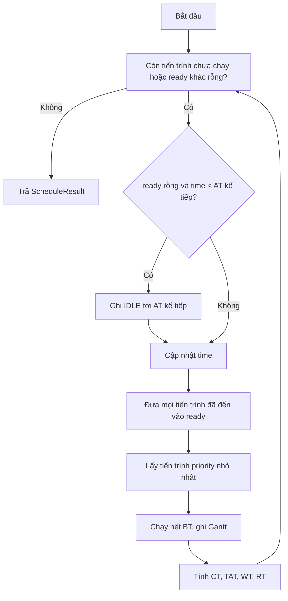
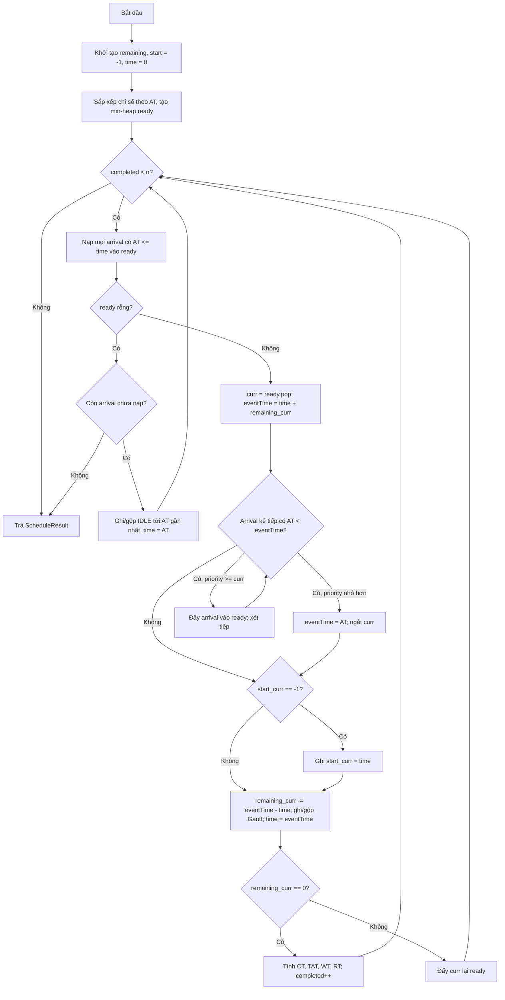

# Pseudocode và flowchart — hai thuật toán

Tài liệu này mô tả thuật toán ở mức độc lập với C++/Qt. Kết quả chuẩn và quy ước
dữ liệu nằm trong [api.md](api.md) và [conventions.md](conventions.md).

## 1. Ký hiệu

| Ký hiệu | Ý nghĩa |
|---|---|
| `AT` | arrival time |
| `BT` | burst time |
| `CT` | completion time |
| `TAT` | turnaround time = `CT - AT` |
| `WT` | waiting time = `TAT - BT` |
| `RT` | response time = lần bắt đầu chạy đầu tiên - `AT` |
| `priority` | số nhỏ hơn = ưu tiên cao hơn |

Quy tắc hòa cho cả hai thuật toán: `priority` nhỏ hơn → `AT` nhỏ hơn → thứ tự dòng CSV.

## 2. Non-preemptive Priority

### 2.1. Pseudocode

```text
function schedule(processes):
    n = length(processes)
    result = array of n empty results
    ready = min-heap ordered by (priority, AT, inputIndex)
    order = indices sorted by AT, giữ thứ tự input khi AT bằng nhau
    time = 0
    next = 0
    gantt = empty

    while next < n or ready is not empty:
        if ready is empty and time < AT[order[next]]:
            gantt.append(IDLE, time, AT[order[next]])
            time = AT[order[next]]

        while next < n and AT[order[next]] <= time:
            ready.push(order[next])
            next = next + 1

        i = ready.pop()
        start = time
        time = time + BT[i]
        gantt.append(pid[i], start, time)

        CT[i] = time
        TAT[i] = CT[i] - AT[i]
        WT[i] = TAT[i] - BT[i]
        RT[i] = start - AT[i]
        result[i] = (pid[i], CT[i], TAT[i], WT[i], RT[i])

    return result, gantt
```

Khi CPU đã chọn một tiến trình, tiến trình đó chạy hết `BT`; tiến trình mới đến
không được chen ngang.

### 2.2. Flowchart



### 2.3. Độ phức tạp

- Thời gian: `O(n log n + g)`, với `g` là số đoạn Gantt.
- Bộ nhớ: `O(n)`.
- Phù hợp với dữ liệu lớn vì dùng heap, không quét lại toàn bộ danh sách mỗi lần.

## 3. Preemptive Priority

### 3.1. Pseudocode

```text
function schedule(processes):
    n = length(processes)
    if n == 0: return empty result
    remaining = copy(BT)
    start = array of n giá trị -1
    result = array of n empty results
    order = [0, 1, ..., n-1] stable_sort theo AT   # giữ thứ tự input khi AT bằng nhau
    ready = min-heap rỗng                          # khóa: (priority, AT, thứ tự input)
    time = 0
    next = 0
    completed = 0
    gantt = empty

    while completed < n:
        # Nạp mọi tiến trình đã đến
        while next < n and AT[order[next]] <= time:
            ready.push(order[next])
            next = next + 1

        # CPU rảnh: nhảy thẳng tới arrival gần nhất
        if ready is empty:
            if next == n: break
            nextTime = AT[order[next]]
            gantt.append_or_merge(IDLE, time, nextTime)
            time = nextTime
            continue

        curr = ready.pop()

        # Chạy tới sự kiện kế tiếp: hết burst hoặc bị ngắt
        eventTime = time + remaining[curr]

        while next < n and AT[order[next]] < eventTime:
            a = order[next]
            if priority[a] < priority[curr]:
                eventTime = AT[a]              # ngắt tại đúng thời điểm arrival
                break
            ready.push(a)                      # priority >= curr: xếp hàng, không ngắt
            next = next + 1

        if start[curr] == -1:
            start[curr] = time

        remaining[curr] = remaining[curr] - (eventTime - time)
        gantt.append_or_merge(pid[curr], time, eventTime)
        time = eventTime

        if remaining[curr] == 0:
            CT[curr] = time
            TAT[curr] = CT[curr] - AT[curr]
            WT[curr] = TAT[curr] - BT[curr]
            RT[curr] = start[curr] - AT[curr]
            result[curr] = (pid[curr], CT[curr], TAT[curr], WT[curr], RT[curr])
            completed = completed + 1
        else:
            ready.push(curr)                   # bị ngắt, chờ lượt tiếp theo

    return result, gantt
```

`RT` luôn tính từ lần chạy đầu tiên, không phải lần quay lại sau khi bị ngắt.
Nếu priority bằng nhau (hoặc arrival mới có priority lớn hơn), tiến trình đang chạy
không bị ngắt. Điều kiện `AT < eventTime` đảm bảo arrival đúng biên không tạo đoạn
Gantt 0 giây: tiến trình đó được nạp ở vòng lặp kế tiếp.

### 3.2. Flowchart



### 3.3. Độ phức tạp và giới hạn

- Thời gian: `O(n log n + g)` — sắp xếp `O(n log n)`, mỗi tiến trình được đẩy/pop
  heap `O(log n)`, mỗi đoạn Gantt ghi `O(1)`. Không phụ thuộc tổng burst `T`.
- Bộ nhớ: `O(n + g)`, với `g` là số đoạn Gantt (kể cả IDLE).
- Cài đặt hiện tại dùng `std::priority_queue` và **mô phỏng theo sự kiện**, không
  quét lại danh sách mỗi tick. Đo thực tế (bản Debug): 100.000 tiến trình khoảng
  0,3–0,5 giây; 500.000 tiến trình khoảng 2,8 giây. Có thể đo lại bằng
  `benchmark_runner` (xem `docs/Preemptive.md` mục 7).
