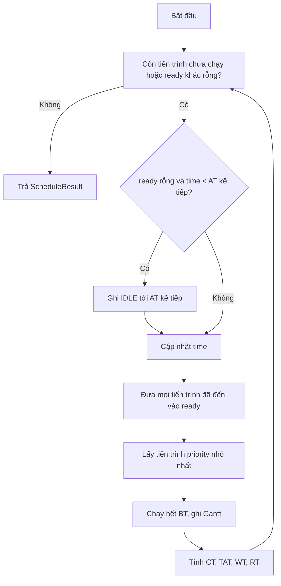
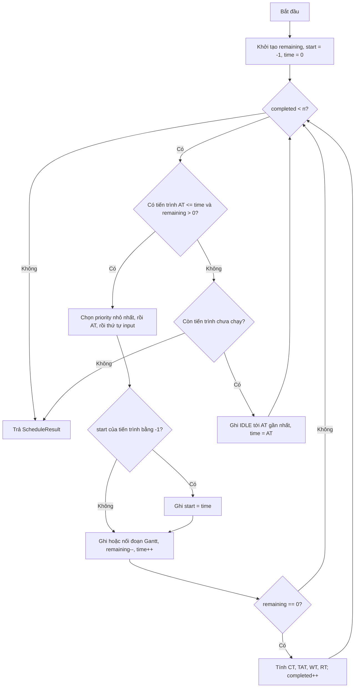

# Pseudocode và flowchart — hai thuật toán

Tài liệu này mô tả thuật toán ở mức độc lập với C++/Qt. Kết quả chuẩn và quy ước
dữ liệu nằm trong [api.md](api.md) và [conventions.md](conventions.md).

## 1. Ký hiệu

| Ký hiệu | Ý nghĩa |
|---|---|
| `AT` | arrival time |
| `BT` | burst time |
| `CT` | completion time |
| `TAT` | turnaround time = `CT - AT` |
| `WT` | waiting time = `TAT - BT` |
| `RT` | response time = lần bắt đầu chạy đầu tiên - `AT` |
| `priority` | số nhỏ hơn = ưu tiên cao hơn |

Quy tắc hòa cho cả hai thuật toán: `priority` nhỏ hơn → `AT` nhỏ hơn → thứ tự dòng CSV.

## 2. Non-preemptive Priority

### 2.1. Pseudocode

```text
function schedule(processes):
    n = length(processes)
    result = array of n empty results
    ready = min-heap ordered by (priority, AT, inputIndex)
    order = indices sorted by AT, giữ thứ tự input khi AT bằng nhau
    time = 0
    next = 0
    gantt = empty

    while next < n or ready is not empty:
        if ready is empty and time < AT[order[next]]:
            gantt.append(IDLE, time, AT[order[next]])
            time = AT[order[next]]

        while next < n and AT[order[next]] <= time:
            ready.push(order[next])
            next = next + 1

        i = ready.pop()
        start = time
        time = time + BT[i]
        gantt.append(pid[i], start, time)

        CT[i] = time
        TAT[i] = CT[i] - AT[i]
        WT[i] = TAT[i] - BT[i]
        RT[i] = start - AT[i]
        result[i] = (pid[i], CT[i], TAT[i], WT[i], RT[i])

    return result, gantt
```

Khi CPU đã chọn một tiến trình, tiến trình đó chạy hết `BT`; tiến trình mới đến
không được chen ngang.

### 2.2. Flowchart



### 2.3. Độ phức tạp

- Thời gian: `O(n log n + g)`, với `g` là số đoạn Gantt.
- Bộ nhớ: `O(n)`.
- Phù hợp với dữ liệu lớn vì dùng heap, không quét lại toàn bộ danh sách mỗi lần.

## 3. Preemptive Priority

### 3.1. Pseudocode

```text
function schedule(processes):
    n = length(processes)
    remaining = copy(BT)
    start = array of n giá trị -1
    result = array of n empty results
    time = 0
    completed = 0
    gantt = empty

    while completed < n:
        best = none

        for i from 0 to n - 1:
            if AT[i] <= time and remaining[i] > 0:
                if best is none
                   or (priority[i], AT[i], i) < (priority[best], AT[best], best):
                    best = i

        if best is none:
            nextArrival = min AT[i] với remaining[i] > 0 và AT[i] > time
            if nextArrival is none:
                break
            gantt.append_or_merge(IDLE, time, nextArrival)
            time = nextArrival
            continue

        if start[best] == -1:
            start[best] = time

        gantt.append_or_merge(pid[best], time, time + 1)
        remaining[best] = remaining[best] - 1
        time = time + 1

        if remaining[best] == 0:
            CT[best] = time
            TAT[best] = CT[best] - AT[best]
            WT[best] = TAT[best] - BT[best]
            RT[best] = start[best] - AT[best]
            result[best] = (pid[best], CT[best], TAT[best], WT[best], RT[best])
            completed = completed + 1

    return result, gantt
```

`RT` luôn tính từ lần chạy đầu tiên, không phải lần quay lại sau khi bị ngắt.
Nếu priority bằng nhau, tiến trình đang chạy không bị ngắt.

### 3.2. Flowchart



### 3.3. Độ phức tạp và giới hạn

- Thời gian: `O(n × T)`, với `T` là tổng thời gian chạy (`sum BT`); tương đương
  `O(n² × B)` nếu mọi burst bị chặn bởi `B`.
- Bộ nhớ: `O(n + g)`.
- Cài đặt hiện tại chạy từng đơn vị thời gian và quét toàn bộ `n` tiến trình mỗi tick.
  Vì vậy dữ liệu rất lớn sẽ chậm; muốn tối ưu cần heap theo priority hoặc mô phỏng
  theo sự kiện. Đây là giới hạn cần nêu trong báo cáo benchmark.
